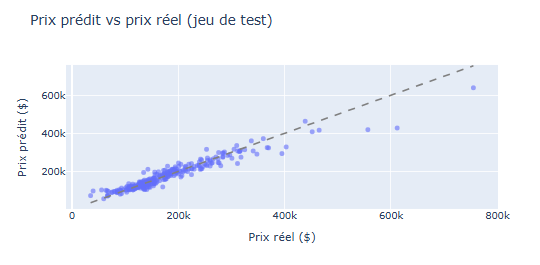

# Projet 6 — Prédiction de Prix Immobiliers 🏠

## Contexte
Construction d'un modèle de régression qui prédit le prix de vente d'une maison à partir de
ses caractéristiques (surface, qualité, quartier, équipements...). Le projet insiste sur la
**rigueur de la méthode** : pas de fuite de données, comparaison à une baseline, validation
croisée, et vérification de l'utilité de chaque choix.

## Dataset
- **Source :** [Ames Housing](https://www.openml.org/search?type=data&name=house_prices) (OpenML), ventes de maisons à Ames (Iowa, USA)
- **Taille :** 1 460 maisons, 80 variables + le prix de vente
- **Découpage :** 1 168 maisons pour l'entraînement, 292 pour le test final (jamais utilisées pour choisir un modèle)

## Méthode
```
Diagnostic ► Cible (log) ► Absences réelles ► Séparation train/test
   ► Feature engineering ► Pipeline (imputation, encodage, standardisation)
   ► Baseline ► Régression linéaire ► Cross-validation ► Ridge / Lasso
   ► Test final ► Analyse des erreurs ► Étude d'ablation
```

## Résultats

| Modèle | RMSE cross-validation (train) | RMSE test |
|---|---|---|
| Baseline (toujours la moyenne) | 0,390 | 0,433 |
| Régression linéaire | 0,164 | 0,127 |
| Ridge (alpha = 30) | 0,140 | 0,135 |
| **Lasso (alpha = 0,001), retenu** | **0,139** | 0,138 |

> Le RMSE est calculé sur le **logarithme** du prix : 0,14 correspond à une erreur de l'ordre de 14 %.

**Erreur du modèle retenu sur le jeu de test :** erreur absolue médiane de **10 708 $**
(moyenne 16 107 $), soit une erreur relative médiane de **6,9 %**.



*Les points sont proches de la diagonale (prédiction parfaite) jusqu'à environ 300 000 $. Au-delà de 350 000 $, les prédictions passent sous la diagonale : le modèle sous-estime les maisons les plus chères.*

## Ce que le projet montre

| # | Constat |
|---|---|
| 1 | **Le log du prix** réduit l'asymétrie de la cible de 1,88 à 0,12 |
| 2 | La plupart des **valeurs manquantes sont des absences réelles** (pas de piscine, de garage, de sous-sol) : les 5 colonnes `Garage*` ont exactement 81 manquants, les mêmes maisons |
| 3 | **Ridge et Lasso réduisent l'erreur de validation croisée de 15 %** par rapport à la régression linéaire (0,164 → 0,139) |
| 4 | **Lasso garde 76 variables sur 284**, à performance équivalente à Ridge : un modèle plus simple et plus explicable |
| 5 | Les plus grosses erreurs sont des **surestimations de maisons bon marché**, et 3 sur 5 sont des ventes atypiques (`Abnorml`, `Alloca`) |
| 6 | Le modèle **sous-estime les maisons les plus chères** (au-delà d'environ 350 000 $) : il « tire vers la moyenne », ce qui est typique d'un modèle régularisé entraîné sur peu d'exemples de ce niveau de prix |

## Limites et honnêteté méthodologique
- **Aucun modèle n'est démontré meilleur.** Sur le test, la régression linéaire (0,127) fait mieux que Lasso (0,138), mais ses 5 scores de validation croisée vont de 0,14 à 0,21 : ce chiffre vient probablement du tirage des 292 maisons. L'écart (0,011) est plus petit que la variabilité d'un découpage à l'autre (≈ 0,03). Lasso a été retenu **avant** de regarder le test, pour sa stabilité et sa simplicité.
- **Le feature engineering n'a pas démontré d'apport.** Une étude d'ablation (Lasso avec et sans les 10 variables créées, 15 découpages) donne un RMSE de 0,1413 contre 0,1414, un écart de 0,0001 bien inférieur à sa variabilité. Beaucoup de variables créées sont des sommes de variables existantes, que le modèle linéaire sait déjà combiner.
- **Les coefficients de Lasso ne se lisent pas au premier degré.** `HasPool` et `PoolArea` portent des coefficients opposés sur seulement 7 maisons, et `HouseAge` a remplacé `YearBuilt` (variables quasi jumelles).
- **Le modèle est moins fiable aux extrêmes de prix.** Sur le nuage de points, quelques maisons de plus de 450 000 $ sont nettement sous-estimées (par exemple une maison vendue environ 610 000 $ est prédite autour de 430 000 $). Le jeu de test ne contient que quelques maisons de ce niveau, donc cette observation est visuelle et non chiffrée : une mesure de l'erreur par tranche de prix serait la suite logique.
- Une seule base de données, une seule ville : les résultats ne se généralisent pas à un autre marché.

## Stack technique


## Structure du repo
```
projet-06-prix-immobiliers/
├── prediction_prix.ipynb   — Analyse complète
├── requirements.txt
└── README.md
```

## Utilisation
```bash
pip install -r requirements.txt
jupyter lab prediction_prix.ipynb
```

## Auteur
**Shanice Marvin Tiogang** · Business Analytics & Data Science · Tunis
